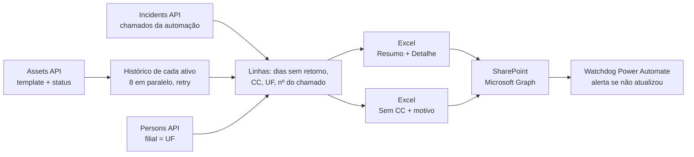

# topdesk-ativos-nao-devolvidos

Script Node.js que gera toda semana o relatório de **equipamentos não devolvidos**
(notebooks, celulares e tablets) a partir da API do TOPdesk. A saída é um Excel com
resumo executivo e detalhe por ativo, publicado no SharePoint via Microsoft Graph.
Um fluxo do Power Automate vigia a execução e avisa quando o relatório não foi
atualizado.

> **Resultado medido:** a execução caiu de **10min23 para 1min28** (~7×) depois de
> limitar a varredura do histórico de cada ativo. As execuções agendadas mais
> recentes levam **42 a 56 segundos**.

---

## Problema

Quando um colaborador sai e não devolve o equipamento, uma automação marca o ativo
como **"Não devolvido"** no Asset Management do TOPdesk e abre um chamado. Faltava
uma visão consolidada: quantos são, de qual centro de custo e estado, e há quantos
dias estão sem retorno.

A API não entrega isso pronto:

- **A data em que o status mudou** não é um campo do ativo; só existe no histórico.
- **O centro de custo some**: a automação zera o campo ao marcar o ativo, então o
  último valor real só aparece como `oldValue` no histórico.
- **O histórico é caro de ler**: o endpoint `/history/pastItems` é paginado só por
  cursor, com 10 itens por página e sem filtro por campo. Em alguns ativos a varredura
  completa passava de 1.500 páginas.

## Solução



1. **Ativos**: busca notebooks e celulares no status "Não devolvido", paginando de
   100 em 100 e pedindo só os campos usados.
2. **Chamados**: carrega os chamados abertos pela automação (filtro por *caller*) e
   associa cada um ao ativo pelo nome do dispositivo no texto.
3. **Histórico**: para cada ativo, procura a data da mudança para "Não devolvido" e o
   último centro de custo. Até 8 requisições simultâneas, retry com backoff
   exponencial e **teto de 100 páginas**. Se o ativo já tem centro de custo, a busca
   só procura a data.
4. **UF**: extraída do padrão do nome do dispositivo (`XX-UF-...`). Quando o nome
   não segue o padrão, vem da filial do usuário antigo, com consulta FIQL e cache.
5. **Excel** (ExcelJS):
   - aba **Resumo** com KPIs, faixas de prazo (≤30 / 31–90 / >90 dias), totais por
     UF e uma tabela centro de custo × tipo;
   - aba **Detalhe** com filtro, cabeçalho congelado e a coluna de dias colorida pela
     faixa.
6. **Sem centro de custo**: os ativos cujo CC não foi recuperado vão para um arquivo
   separado, com o **motivo** de cada um ("cortado no limite de páginas", "histórico
   esgotado sem evento de CC"…), para a equipe preencher no TOPdesk.
7. **SharePoint**: upload via Microsoft Graph com *client credentials*. Se o arquivo
   estiver aberto (HTTP 423), a mensagem explica o que fazer.
8. **Segredos**: nada em texto puro. O `.env` guarda referências `op://` e o
   1Password CLI (`op run`) injeta os valores só durante a execução.
9. **Watchdog**: um fluxo do Power Automate roda toda segunda de manhã, lê os
   metadados do arquivo no SharePoint e envia alerta se ele não foi atualizado.

---

## Como usar

Requisitos:
- Node.js 18 ou superior (usa o `fetch` nativo);
- [1Password CLI](https://developer.1password.com/docs/cli/) (opcional, mas
  recomendado);
- um usuário de API no TOPdesk com *application password*;
- um app registration no Entra ID com permissão no site do SharePoint.

```bash
npm install
cp .env.example .env      # preencha com os IDs da sua instância e referências op://
```

```bat
:: execução manual
exportar.bat

:: execução agendada (Agendador de Tarefas); acrescenta a saída em exportar.log
exportar_agendado.bat
```

Sem 1Password, preencha os valores direto no `.env` e rode `npm start`. O `.env`
está no `.gitignore`.

| Variável | Para quê |
|---|---|
| `TOPDESK_URL`, `TOPDESK_EMAIL`, `TOPDESK_TOKEN` | Acesso à API (Basic com *application password*) |
| `TOPDESK_TEMPLATE_NOTEBOOK`, `TOPDESK_TEMPLATE_CELULAR` | Templates de ativo consultados |
| `TOPDESK_STATUS_NAO_DEVOLVIDO` | ID do status "Não devolvido" |
| `TOPDESK_AUTOMATION_CALLER_ID` | Pessoa usada pela automação que abre os chamados |
| `AZURE_TENANT_ID`, `AZURE_CLIENT_ID`, `AZURE_CLIENT_SECRET` | Token do Microsoft Graph |
| `SHAREPOINT_SITE_URL`, `SHAREPOINT_FOLDER`, `SHAREPOINT_FILENAME` | Destino do relatório principal |
| `SHAREPOINT_EXAURIDOS_*` | Destino do relatório sem centro de custo (opcional) |

> Os relatórios gerados contêm nome de colaboradores e patrimônio. Não versione as
> saídas: `*.xlsx` e `*.log` já estão no `.gitignore`.

---

## Resultados medidos

A versão anterior lia o histórico inteiro de cada ativo. Os números abaixo foram
medidos no mesmo dia, sobre a mesma base de ativos, com `console.time` por etapa:

| Métrica | Antes | Depois | |
|---|---|---|---|
| Tempo total | 10min23 | **1min28** | ~7× mais rápido |
| Varredura do histórico | 10min08 | **1min06** | |
| Páginas de histórico lidas | 22.715 | **2.705** | −88% |
| Média de páginas por ativo | ~324,5 | **~38,6** | |
| Eventos de histórico lidos | 227.093 | **27.039** | |
| Ativos sem data de status | 0 | 0 | nenhuma perda |

**Custo da otimização:** com o teto de páginas, 2 ativos a mais ficaram sem centro
de custo recuperado. Eles não somem: vão para o relatório "sem CC" com o motivo
"cortado no limite de 100 páginas".

As execuções agendadas de set–out/2026 levaram **42 a 56 segundos**, do início até
o upload no SharePoint.

---

## Decisões

- **Teto de páginas em vez de varredura completa.** O ganho de tempo vale mais que
  recuperar o CC de poucos ativos. Os que ficam sem CC aparecem num relatório
  próprio, com o motivo, para correção manual.
- **`oldValue` como fonte do centro de custo.** A automação zera o campo ao mudar o
  status, então o último valor real está no `oldValue` do evento de histórico.
- **Concorrência limitada (8).** É rápido sem provocar *throttling* da API.
- **Dois relatórios com regras diferentes, e uma nota explicando por quê.** O
  consolidado inclui ativos sem CC e filtra por data; os arquivos diários por centro
  de custo (outro fluxo) não fazem nenhuma das duas coisas. A nota no rodapé evita o
  chamado de "os números não batem".

## Licença

[MIT](LICENSE) © Jonatas Alves
