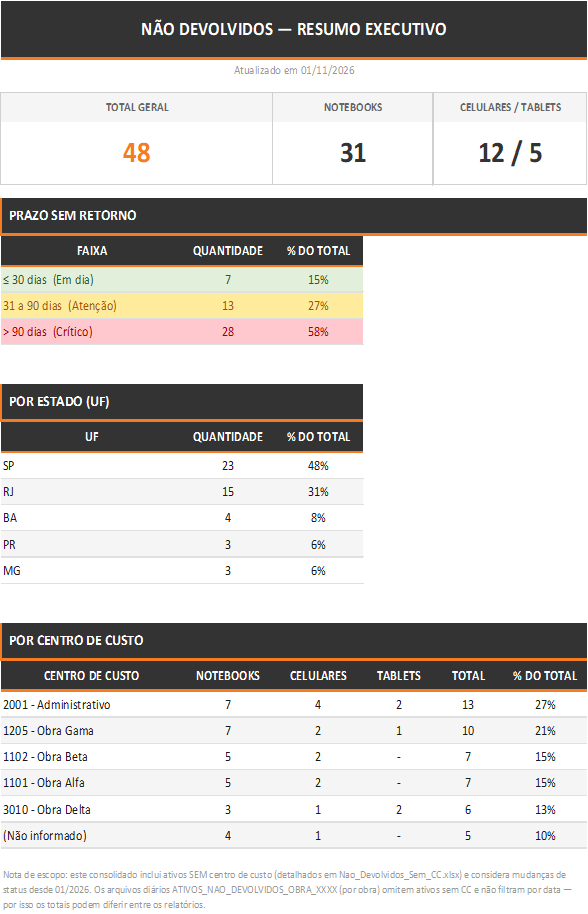
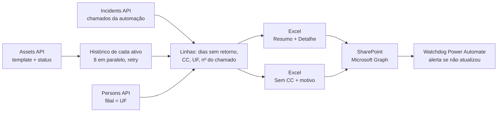
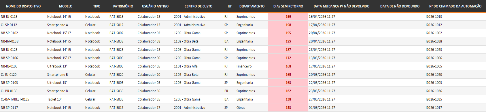

# Relatório de equipamentos não devolvidos

[](https://github.com/JonatasAlves21/topdesk-ativos-nao-devolvidos/actions/workflows/testes.yml)


**Em poucas palavras:** quando alguém sai da empresa, precisa devolver para a TI o
notebook e o celular que usava. Cada equipamento não devolvido fica registrado num
chamado, mas ninguém enxergava o todo. Este projeto junta todos esses casos num
relatório que a gestão recebe **toda segunda-feira**, sem ninguém montar nada à mão.

- **O que o relatório mostra:** quantos equipamentos estão fora, de quais centros de
  custo e estados, e há quantos dias.
- **Como funciona:** um script em Node.js lê os dados da plataforma de service desk
  pela API, monta uma planilha Excel com o resumo e publica no SharePoint. Se a
  planilha não for atualizada, um fluxo do Power Automate avisa a equipe.
- **Resultado:** depois de uma otimização, o relatório passou de **10min23 para
  1min28** (cerca de 7× mais rápido).

**Destaques**

- ⏱️ Execução **~7× mais rápida** (de 10min23 para 1min28) depois de limitar quantas páginas do histórico de cada equipamento o script lê.
- 🔍 Recupera dados que a API não entrega prontos: a **data em que o status mudou** e o **centro de custo apagado** pela automação.
- 📊 Relatório pronto para a gestão: indicadores, faixas de prazo, totais por estado e por centro de custo.
- 🔐 Nenhuma senha no código: as credenciais ficam num cofre de senhas e só são usadas na hora da execução.
- ✅ Regras de negócio cobertas por testes automáticos, que rodam no GitHub Actions a cada mudança.



<sub>Imagem gerada com `npm run exemplo`, só com dados fictícios.</sub>

---

## Problema

Quando um colaborador sai e não devolve o equipamento, uma automação marca o ativo
como **"Não devolvido"** no módulo de ativos da plataforma de service desk e abre um
chamado. Faltava
uma visão consolidada: quantos são, de qual centro de custo e estado, e há quantos
dias estão sem retorno.

A API não entrega isso pronto:

- **A data em que o status mudou** não é um campo do ativo; só existe no histórico.
- **O centro de custo some**: a automação zera o campo ao marcar o ativo, então o
  último valor real só aparece como `oldValue` no histórico.
- **O histórico é caro de ler**: o endpoint `/history/pastItems` é paginado só por
  cursor, com 10 itens por página e sem filtro por campo. Em alguns ativos a varredura
  completa passava de 1.500 páginas.

## Solução



1. **Ativos**: busca notebooks e celulares no status "Não devolvido", paginando de
   100 em 100 e pedindo só os campos usados.
2. **Chamados**: carrega os chamados abertos pela automação (filtro por *caller*) e
   associa cada um ao ativo pelo nome do dispositivo no texto.
3. **Histórico**: para cada ativo, procura a data da mudança para "Não devolvido" e o
   último centro de custo. Até 8 requisições simultâneas, retry com backoff
   exponencial e **teto de 100 páginas**. Se o ativo já tem centro de custo, a busca
   só procura a data.
4. **UF**: extraída do padrão do nome do dispositivo (`XX-UF-...`). Quando o nome
   não segue o padrão, vem da filial do usuário antigo, com consulta FIQL e cache.
5. **Excel** (ExcelJS):
   - aba **Resumo** com KPIs, faixas de prazo (≤30 / 31–90 / >90 dias), totais por
     UF e uma tabela centro de custo × tipo;
   - aba **Detalhe** com filtro, cabeçalho congelado e a coluna de dias colorida pela
     faixa.
6. **Sem centro de custo**: os ativos cujo CC não foi recuperado vão para um arquivo
   separado, com o **motivo** de cada um ("cortado no limite de páginas", "histórico
   esgotado sem evento de CC"…), para a equipe preencher na plataforma.
7. **SharePoint**: upload via Microsoft Graph com *client credentials*. Se o arquivo
   estiver aberto (HTTP 423), a mensagem explica o que fazer.
8. **Segredos**: nada em texto puro. O `.env` guarda só referências `op://` ao cofre
   de senhas, e a CLI do cofre (`op run`) injeta os valores só durante a execução.
9. **Watchdog**: um fluxo do Power Automate roda toda segunda de manhã, lê os
   metadados do arquivo no SharePoint e envia alerta se ele não foi atualizado.



---

## Stack

| | |
|---|---|
| Linguagem | Node.js 18+ (`fetch` nativo), CommonJS |
| APIs | API REST da plataforma de service desk (Assets, History, Incidents, Persons), Microsoft Graph |
| Excel | [ExcelJS](https://github.com/exceljs/exceljs) |
| Segredos | CLI do cofre de senhas (`op run`) |
| Agendamento | Agendador de Tarefas do Windows + watchdog no Power Automate |
| Testes | `node:test` (nativo, sem dependência extra) + GitHub Actions |

## Estrutura do projeto

```
export.js              ponto de entrada: encadeia as etapas e cronometra cada uma
src/
  config.js            variáveis de ambiente e validação das obrigatórias
  topdesk.js           chamadas à API da plataforma: ativos, histórico, pessoas e chamados
  regras.js            regras de negócio puras (UF, dias sem retorno, vínculo de
                       chamados, montagem das linhas, motivo do "sem CC")
  util.js              retry com backoff, limite de concorrência, datas, EBUSY
  sharepoint.js        token do Microsoft Graph e upload
  diagnostico.js       ranking dos ativos mais lentos no histórico
  excel/
    estilo.js          paleta e faixas de prazo
    resumo.js          aba Resumo (KPIs, UF, centro de custo)
    detalhe.js         aba de detalhe
    sem-cc.js          relatório dos ativos sem centro de custo
    index.js           gravação dos dois arquivos
scripts/
  gerar-exemplo.js     relatórios com dados fictícios, sem acessar a plataforma
test/                  testes das regras, utilitários e geração do Excel
```

O que é regra de negócio fica em `src/regras.js` e em `summarize()`, em
`src/excel/resumo.js`, sem chamada de rede. Por isso dá para testar tudo sem acesso
à plataforma de service desk.

---

## Como usar

### Ver o resultado só com dados fictícios

```bash
npm install
npm run exemplo   # gera exemplo_nao_devolvidos.xlsx e exemplo_nao_devolvidos_sem_cc.xlsx
npm test          # roda os testes
```

### Rodar na sua instância

Requisitos:
- Node.js 18 ou superior (usa o `fetch` nativo);
- a CLI do cofre de senhas (`op`), opcional, mas recomendada;
- um usuário de API na plataforma de service desk com *application password*;
- um app registration no Entra ID com permissão no site do SharePoint.

```bash
npm install
cp .env.example .env      # preencha com os IDs da sua instância e referências op://
```

```bat
:: execução manual
exportar.bat

:: execução agendada (Agendador de Tarefas); acrescenta a saída em exportar.log
exportar_agendado.bat
```

Sem o cofre de senhas, preencha os valores direto no `.env` e rode `npm start`. O
`.env` está no `.gitignore`.

Se faltar alguma variável da plataforma, o script para antes de chamar a API e lista
quais estão ausentes: com um ID vazio, as consultas sairiam sem filtro.

| Variável | Para quê |
|---|---|
| `TOPDESK_URL`, `TOPDESK_EMAIL`, `TOPDESK_TOKEN` | Acesso à API da plataforma (Basic com *application password*) |
| `TOPDESK_TEMPLATE_NOTEBOOK`, `TOPDESK_TEMPLATE_CELULAR` | Templates de ativo consultados |
| `TOPDESK_STATUS_NAO_DEVOLVIDO` | ID do status "Não devolvido" |
| `TOPDESK_AUTOMATION_CALLER_ID` | Pessoa usada pela automação que abre os chamados |
| `AZURE_TENANT_ID`, `AZURE_CLIENT_ID`, `AZURE_CLIENT_SECRET` | Token do Microsoft Graph |
| `SHAREPOINT_SITE_URL`, `SHAREPOINT_FOLDER`, `SHAREPOINT_FILENAME` | Destino do relatório principal |
| `SHAREPOINT_EXAURIDOS_*` | Destino do relatório sem centro de custo (opcional) |

> Os relatórios gerados contêm nome de colaboradores e patrimônio. Não versione as
> saídas: `*.xlsx` e `*.log` já estão no `.gitignore`.

---

## Resultados medidos

A versão anterior lia o histórico inteiro de cada ativo. Os números abaixo foram
medidos no mesmo dia, sobre a mesma base de ativos, com `console.time` por etapa:

| Métrica | Antes | Depois | |
|---|---|---|---|
| Tempo total | 10min23 | **1min28** | ~7× mais rápido |
| Varredura do histórico | 10min08 | **1min06** | |
| Páginas de histórico lidas | 22.715 | **2.705** | −88% |
| Média de páginas por ativo | ~324,5 | **~38,6** | |
| Eventos de histórico lidos | 227.093 | **27.039** | |
| Ativos sem data de status | 0 | 0 | nenhuma perda |

**Custo da otimização:** com o teto de páginas, 2 ativos a mais ficaram sem centro
de custo recuperado. Eles não somem: vão para o relatório "sem CC" com o motivo
"cortado no limite de 100 páginas".

As execuções agendadas de set–out/2026 levaram **42 a 56 segundos**, do início até
o upload no SharePoint.

---

## Decisões

- **Teto de páginas em vez de varredura completa.** O ganho de tempo vale mais que
  recuperar o CC de poucos ativos. Os que ficam sem CC aparecem num relatório
  próprio, com o motivo, para correção manual.
- **`oldValue` como fonte do centro de custo.** A automação zera o campo ao mudar o
  status, então o último valor real está no `oldValue` do evento de histórico.
- **Concorrência limitada (8).** É rápido sem provocar *throttling* da API.
- **Dois relatórios com regras diferentes, e uma nota explicando por quê.** O
  consolidado inclui ativos sem CC e filtra por data; os arquivos diários por centro
  de custo (outro fluxo) não fazem nenhuma das duas coisas. A nota no rodapé evita o
  chamado de "os números não batem".
- **Regras separadas da rede.** A lógica que decide datas, centro de custo, UF e
  motivo fica em funções puras, testadas sem rede. As chamadas à API da plataforma
  ficam em `src/topdesk.js`.

## Licença

[MIT](LICENSE) © Jonatas Alves
